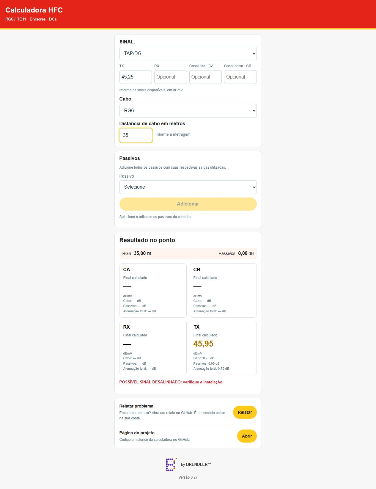

# Calculadora HFC

## Visual da calculadora

Versão 0.28 — by BRENDLER™.

Calculadora de atenuação para cabos RG6 e RG11, divisores e DCs.

## Acessar a calculadora

[Abrir calculadora HFC](https://calculadora-hfc.pages.dev/)

## Relatar problemas

Use o botão Relatar problema na calculadora ou abra uma issue em https://github.com/fbrendler/calculadora-hfc/issues.

## Uso

Abra `index.html` em um navegador. Selecione onde o sinal foi medido (TAP/DG ou Ponto), preencha os sinais disponíveis, informe a metragem e adicione os passivos com as saídas utilizadas. O cálculo ocorre automaticamente no sentido correspondente.

Os sinais são opcionais. Metragem vazia equivale a zero metro. Os coeficientes dos cabos são fixos; a atenuação dos passivos é somada em série. As cores e avisos seguem os limites definidos para cada destino.

## Publicação

O arquivo `index.html` é autossuficiente e pode ser enviado ao Cloudflare Pages. Site publicado em https://calculadora-hfc.pages.dev/.

## Versionamento

Incrementar o número exibido no rodapé em 0.01 a cada solicitação de alteração implementada.
